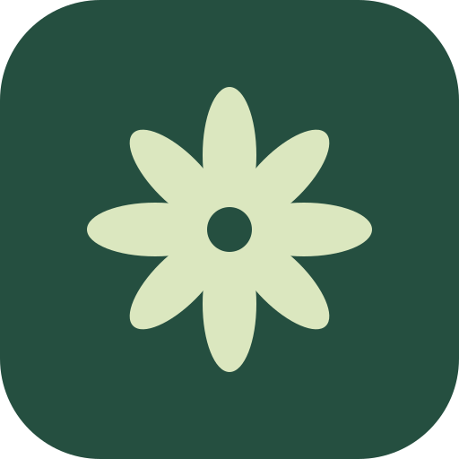
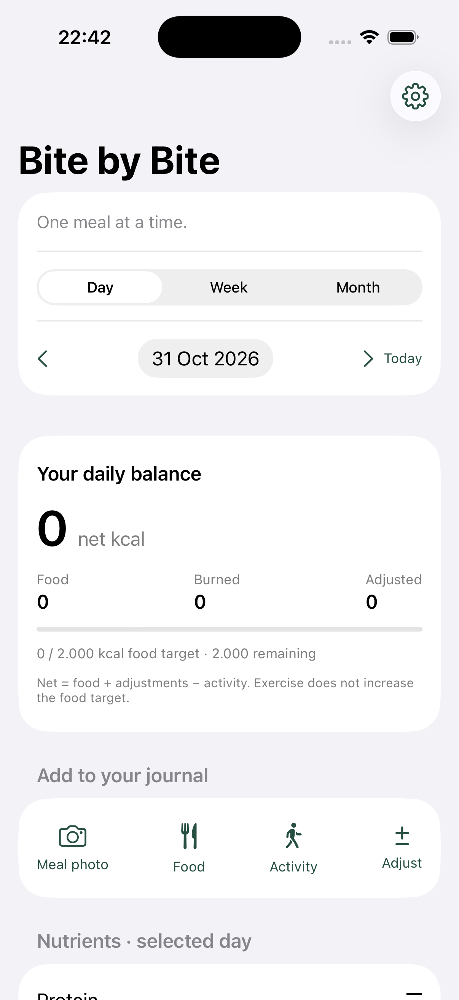

# Bite by Bite

A personal food journal I built to make everyday tracking easier. Take a meal photo, add a note like “I only ate half,” and review the calorie and nutrient estimate before saving it.

Track meals, activity, water, supplements, and progress by day, week, and month. Edit estimates or add calories manually whenever you need to.



*iPhone preview with an empty demo journal.*

## iPhone

Open `mobile/ios/BiteByBite.xcodeproj` in Xcode, choose your connected iPhone, then press **⌘R**. The journal lives on the phone; no laptop server is needed. Photo estimates require internet and a supported ChatGPT connection.

Copy `mobile/ios/Local.xcconfig.example` to `Local.xcconfig` in the same folder and enter your Apple team ID. This local file is ignored by Git. Free Apple signing needs renewal every seven days.

[More about the iPhone app](mobile/ios/README.md)

## Web app

Requires Node.js 22.13 or newer. No npm dependencies.

```sh
cp .env.example .env
npm start
```

Open http://localhost:3000 and create an account. The web version saves each account’s journal on the server. Phone and web journals can be transferred with JSON backups; they don't sync automatically.

[Web setup and details](docs/web.md)

## Development

```sh
npm test
```

Native check instructions are in the [iPhone guide](mobile/ios/README.md).

## Privacy

Local data, credentials, backups, and signing settings are excluded from Git. Photos are sent to OpenAI when you request an estimate. Estimates are approximate, so check portions and values before saving.
